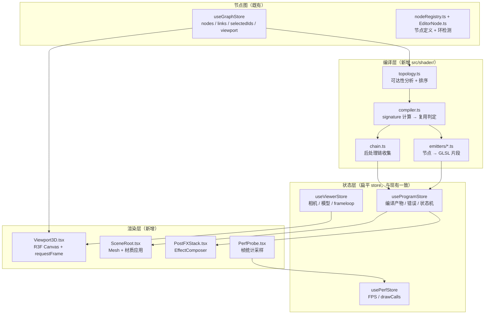
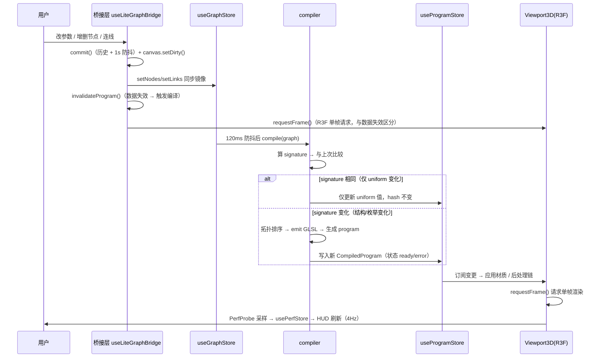

# 3D 预览 · Shader 节点 · 后处理扩展实现指导

> **版本**：v3.0（阶段 0–F 已实现；末尾附实现偏差记录）  
> **日期**：2026-11-18  
> **定位**：`Ref_React-LiteGraph节点面板项目规划.md` 的独立后续功能扩展说明  
> **技术栈基线**：React 18 + TypeScript + Vite 6 + Zustand 5 + `@comfyorg/litegraph@0.17.2` + R3F v8 系列  
> **前置依赖（已实现）**：主文档阶段 0–5 已完成（`README.md` 自述）。当前事实：
> - 桥接层 `src/graph/useLiteGraphBridge.ts` 驱动 LGraph ↔ `useGraphStore` 镜像；`canvas.ds` 是画布视口唯一真相源。
> - 节点定义拆分为纯数据 `src/graph/nodeDefinitions.ts`（5 个 ComfyUI 节点 + 19 个 shader/postfx 节点），注册在 `nodeRegistry.ts`；端口类型 20 项。
> - 双格式模型 `WorkflowUI` / `PromptAPI`、`parseWorkflow` 三级校验、`toPromptAPI` 已实现；**`SCHEMA_VERSION = 2`**，`migrateWorkflow` 已实现 v1 → v2。
> - 已落地：`src/graph/coords.ts` 统一坐标转换；桥接层 `commit()` 串联历史/持久化/`invalidateProgram()`；端口文本继续读 `port.name`（不引入 `getPortDisplayText`）。
> - 已落地：three 0.169 / R3F 8.18 / drei 9.122 / postprocessing 2.19 / `@types/three` 0.169；3D 视口、编译器、后处理、性能 HUD 均可用。

## 实现进度

| 阶段 | 内容 | 状态 |
|---|---|---|
| 0 | 依赖 Spike、`coords.ts` 统一坐标 | 完成 |
| A | 3D 视口骨架、ViewerDock 布局、glTF 上传 | 完成 |
| B | 20 个端口类型、19 个新节点、topology、连接校验 | 完成 |
| C | signature、emitters、PBR/Unlit、compiler、chain、invalidateProgram | 完成 |
| D | SceneRoot、Lights、PostFXStack、PerfProbe | 完成 |
| E | SceneOverview、Surface/Environment/PostFX 表单、错误标红 | 完成 |
| F | contextLoss、schema v2 迁移、测试与验收 | 完成 |

---

## 0. 文档定位与三项硬约束

本文件不是概念介绍，而是**按此顺序执行即可产出可运行功能**的实现清单。以下三条是修订后的约束，已对齐当前代码实际形态：

1. **两套视口状态严格隔离**：节点图画布视口仍是 `canvas.ds`（唯一真相源，镜像到 `useGraphStore.viewport`，覆盖层 CSS transform 由它派生）；3D 视口相机状态放独立 `useViewerStore`。两者不得互相读写，也不得共用 `viewport` 字段。
2. **数据变更走既有统一入口**：任何节点数据变更必须经 `useGraphActions.setWidgetValue` / 桥接层 `addNode` 等入口，由桥接层统一 `commit()`（历史 + 1s 防抖持久化）+ `canvas.setDirty()`；本扩展在该链路**追加** `invalidateProgram()`。禁止 React 组件直接写 `LGraph`。注意：当前代码没有名为 `invalidate(nodeId)` 的函数，该语义由 `commit()` + `setDirty()` 承担。
3. **坐标转换先建立单一入口再扩展 3D**：阶段 0 抽出 `src/graph/coords.ts`，把散落在 `GraphCanvas.tsx`、`useLiteGraphBridge.ts`、`measure.ts`、`NodeOverlay.tsx` 的转换统一为 `screenToGraph()` / `graphToScreen()`，之后所有代码只调用它。端口显示文本**继续读 `port.name`**——研究报告 v1.1 已否决 `getPortDisplayText` 抽象（写入侧保证 `name` 非空即可），本扩展不引入 `label` 字段。

**命名约定（避免踩坑）**：R3F 请求单帧渲染的 `invalidate()` 一律封装为 `requestFrame()`（`src/viewer/requestFrame.ts`），与数据失效链路彻底区分。

---

## 1. 功能范围

### 1.1 In Scope

| 编号 | 功能 | 具体交付 |
|---|---|---|
| F1 | 左侧 3D 渲染视图 | R3F Canvas；内置几何体（Box / Sphere / TorusKnot）+ GLTF 文件上传；`OrbitControls` 相机控制；实时预览图变化 |
| F2 | 属性区 shader 配置 | 选中节点后在 Inspector 显示对应参数表单；`render/Environment` 节点暴露光照（环境光/平行光强度、光源位置）与阴影（开关、贴图尺寸、bias）参数 |
| F3 | 材质与 shader 节点 | 颜色、纹理采样、数值常量、数学运算、向量、UV / 法线 / 时间、颜色混合、`material/Surface` 输出 |
| F4 | 后处理节点 | Bloom、SSAO、Vignette、FXAA 四类效果节点 + `postfx/Output`；支持添加、删除、参数配置与链式连接；结果应用到左侧渲染 |
| F5 | 性能观察 | FPS / 帧时间 / draw calls / 三角面数实时 HUD；shader 编译状态与错误显示 |

### 1.2 Out of Scope

- 通用 GLSL 文本编辑器（v1 仅节点生成代码，不开放手写源码）。
- 多材质槽、多 Mesh 的复杂场景图（v1 单 Mesh + 单材质）。
- 自定义阴影 shader、延迟渲染、多灯光的节点化配置。
- 后处理效果乱序并行分支（v1 仅单链）。
- WebGPU 渲染路径（v1 仅 WebGL2；架构预留接口）。
- glTF 动画、骨骼与蒙皮。

### 1.3 布局裁决（必须执行）

当前 `src/index.css` 的实际值是：左栏 `.node-library` 为 `flex: 0 0 240px`，右栏 `.side-panel` 为 `flex: 0 0 300px`，断点 1280 / 1024 / 860px（规划文档文字里的"260px"与代码不符，以代码为准）。新增 3D 视口后裁决如下，**布局一律用 flex，不引入 grid**：

| 区域 | 尺寸 | 说明 |
|---|---|---|
| 左栏 | 默认 **360px**，可拖拽调整 300–520px | 在 `App.tsx` 的 `.workspace` 内新增 `ViewerDock` 容器，垂直切分 |
| ├ 上部：3D Viewport | 高度占比 **60%**，最小 240px | R3F Canvas + 性能 HUD 浮层 |
| └ 下部：Node Library | 高度占比 40%，可折叠 | 折叠后 3D 视口占满左栏 |
| 画布区 | `flex: 1 1 0; min-width: 0` | `GraphCanvas` 保持不变 |
| 右侧 Inspector | `flex: 0 0 300px` | `SidePanel` 保持不变 |

响应式（基于现有断点扩展）：

| 宽度 | 行为 |
|---|---|
| ≥ 1400px | 左栏 360px，上部 3D、下部节点库 |
| 1280–1400px | 左栏 320px，Node Library 默认折叠（可展开） |
| 1024–1280px | 沿用现有 1280px 断点：节点库收窄 200px，Inspector 300px 保留 |
| < 1024px | 左栏退化为抽屉，工具栏按钮唤出；右侧 Inspector 按现有规则隐藏 |

---

## 2. 核心模块划分



**模块职责边界**：

| 模块 | 输入 | 输出 | 禁止事项 |
|---|---|---|---|
| `compiler` | `WorkflowUI` 快照 | `CompiledProgram` | 不得 import R3F / three（保持纯函数，可单测） |
| `emitters` | `EmitContext` | `{ expr, type, uniforms }` | 不得直接访问全局 store |
| `Viewport3D` | `CompiledProgram` + `useViewerStore` | 像素 | 不得修改节点图数据 |
| `PostFXStack` | `postfxChain` | 像素 | 不得自行重排效果顺序 |
| `InspectorPanel` | `useGraphStore.selectedIds` | Action 调用 | 不得直接写 `LGraph` |

---

## 3. 节点类型与连接规则

### 3.1 扩展端口类型

**在 `src/graph/workflow.ts` 的既有 `PORT_TYPES` 上追加**，不要覆盖（漏掉 `CONTROL_NET` / `SIGMAS` 会导致示例工作流导入时类型降级为 `*`）：

```ts
export const PORT_TYPES = [
  // 既有 14 项，全部保留
  'MODEL', 'CLIP', 'VAE', 'CONDITIONING', 'LATENT',
  'IMAGE', 'MASK', 'CONTROL_NET', 'SIGMAS',
  'INT', 'FLOAT', 'STRING', 'BOOLEAN', '*',
  // 新增：shader 值类型
  'VEC2', 'VEC3', 'COLOR',
  // 新增：资源与终端类型
  'GEOMETRY', 'MATERIAL', 'POSTFX',
] as const
export type PortType = (typeof PORT_TYPES)[number]
```

同时在 `src/graph/portTypes.ts` 的 `PORT_COLORS` 追加 6 个色值（该文件是 React 端口与 `LGraphCanvas.link_type_colors` 的共同来源，`installTypeSystem()` 会自动同步到画布）：

| 类型 | 写入 `PORT_COLORS` 的色值 | 亮色主题说明 |
|---|---|---|
| `VEC2` | `#85B7EB` | 画布与 React 共用同一色值，不另设 CSS 变量 |
| `VEC3` | `#7F77DD` | 同上 |
| `COLOR` | `#D4537E` | 同上 |
| `GEOMETRY` | `#1D9E75` | 同上 |
| `MATERIAL` | `#BA7517` | 同上 |
| `POSTFX` | `#378ADD` | 同上 |

### 3.2 节点目录（v1 全量）

既有 5 个 ComfyUI 节点（`loaders/CheckpointLoader`、`conditioning/CLIPTextEncode`、`sampling/KSampler`、`latent/EmptyLatentImage`、`image/VAEDecode`）保持不动。以下 19 个为新增，统一注册进 `nodeRegistry.ts`：

**场景与材质域**

| type | 分类 | 输入 | 输出 | Widget | 编译行为 |
|---|---|---|---|---|---|
| `scene/Mesh` | scene | — | `geometry: GEOMETRY` | `shape`(box/sphere/torusknot/gltf), `assetId`, `scale` | 不产出 GLSL；驱动 `SceneRoot` 创建 Mesh |
| `scene/Root` | scene | `geometry: GEOMETRY`, `material: MATERIAL` | — | — | **终端节点**；场景唯一渲染根 |
| `material/Surface` | material | `baseColor: COLOR`, `roughness: FLOAT`, `metalness: FLOAT`, `emissive: COLOR` | `material: MATERIAL` | `shading`(pbr/unlit) | 生成 PBR 注入或 ShaderMaterial |
| `render/Environment` | render | — | — | `ambient`, `dirIntensity`, `lightPosX/Y/Z`, `shadowEnabled`, `shadowMapSize`, `shadowBias` | 不参与 GLSL；驱动 Lights 与 Renderer 配置 |

**Shader 值域**

| type | 输入 | 输出 | Widget | emit 产物 |
|---|---|---|---|---|
| `shader/Float` | — | `FLOAT` | `value` | uniform `f_<id>` |
| `shader/Color` | — | `COLOR` | `value`(color) | uniform `c_<id>` |
| `shader/UV` | — | `VEC2` | — | `vUv` |
| `shader/Normal` | — | `VEC3` | — | `normalize(vNormal)` |
| `shader/Position` | — | `VEC3` | — | `vViewPosition` |
| `shader/Time` | — | `FLOAT` | `speed` | uniform `uTime`（逐帧更新） |
| `shader/Texture` | `uv: VEC2` | `COLOR` | `assetId`, `wrap`, `flipY` | uniform sampler2D `tex_<id>` |
| `shader/Math` | `a: FLOAT`, `b: FLOAT` | `FLOAT` | `op`(add/sub/mul/div/sin/pow/lerp) | `(a <op> b)` |
| `shader/MixColor` | `a: COLOR`, `b: COLOR`, `t: FLOAT` | `COLOR` | — | `mix(a, b, clamp(t,0.,1.))` |
| `shader/Vec3` | — | `VEC3` | `x`, `y`, `z` | uniform `v3_<id>` |

**后处理域**

| type | 输入 | 输出 | Widget | 对应实现 |
|---|---|---|---|---|
| `postfx/Bloom` | `in: POSTFX` | `out: POSTFX` | `intensity`, `luminanceThreshold`, `mipmapBlur` | `<Bloom />` |
| `postfx/SSAO` | `in: POSTFX` | `out: POSTFX` | `samples`, `radius`, `intensity` | `<SSAO />` |
| `postfx/Vignette` | `in: POSTFX` | `out: POSTFX` | `darkness`, `offset` | `<Vignette />` |
| `postfx/FXAA` | `in: POSTFX` | `out: POSTFX` | — | `<SMAA />` 或 FXAA pass |
| `postfx/Output` | `effects: POSTFX` | — | — | **终端节点；链尾**（从它逆序收集整条链） |

### 3.3 连接校验规则（注入既有链路，不另起一套）

当前项目已有三段校验：**`portTypes.ts:isValidTypePair()`**（类型）+ **`EditorNode.ts:canReach()`**（环检测，`onConnectOutput`/`onConnectInput`）+ **`connectionFeedback.ts`**（拒绝原因 → Toast），由 `installTypeSystem()` 覆写 `LiteGraph.isValidConnection` 接入。本扩展只做增量扩展：

```ts
// src/graph/portTypes.ts —— 扩展既有纯函数，不要新建 validate.ts / canConnect()
export function isValidTypePair(a: string, b: string): boolean {
  // 既有规则：相等 / 通配 * / 逗号联合类型 / INT↔FLOAT
  // 新增规则 1：FLOAT → VEC3 / COLOR 标量广播
  // 新增规则 2：COLOR ↔ VEC3 直接赋值（色彩空间见 8.7）
  // 新增规则 3：MATERIAL / GEOMETRY / POSTFX 只允许同类型或 *，实现域隔离
  // ...
}
```

- **环检测继续复用 `EditorNode.ts` 的 `canReach()`**；`src/shader/topology.ts` 只提供编译期需要的 `getReachableNodes()` / `topoSort()`，不重复实现连线拦截。
- 拒绝提示继续走 `reportConnectionError()` → `useToastStore`，不新增提示通道。

类型兼容矩阵：

| 源 → 目标 | 是否允许 | 转换方式 |
|---|---|---|
| `FLOAT` → `VEC3` / `COLOR` | ✅ | 标量广播 `vec3(x)` |
| `COLOR` ↔ `VEC3` | ✅ | 直接赋值（注意色彩空间，见 8.7） |
| `FLOAT` → `VEC2` | ❌ | 需显式 `shader/Vec3` 节点 |
| `MATERIAL` → 任意 shader 值 | ❌ | 域隔离 |
| `POSTFX` → 非 `POSTFX` | ❌ | 域隔离 |
| `GEOMETRY` → `MATERIAL` | ❌ | 域隔离 |
| 任意 → `*` | ✅ | 通配 |
| `INT` ↔ `FLOAT`（既有） | ✅ | 数值兼容，保持不变 |

**终端约束**：
- `scene/Root` 最多 1 个 active 实例；多个时以 `config.activeRoot` 指定，其余标记警告。
- `postfx/Output` 最多 1 个 active 实例。
- 无 `scene/Root` 时渲染默认 Box + 默认白材质（保证视图不空）。

---

## 4. 状态流转

### 4.1 编译与预览主流程



### 4.2 编译状态机

```
idle ──graph change──> dirty ──debounce 120ms──> compiling
                                                   ├─ success ─> ready
                                                   └─ failure ─> error（保留 lastGoodProgram）
ready/error ──new change──> dirty
```

**关键规则**：编译失败时**不清空** `lastGoodProgram`，视口继续显示上一次成功结果，同时在出错节点与 Inspector 显示错误。这是保证"调参过程不闪屏"的核心。

### 4.3 结构变化 vs Uniform 变化

在既有 `NodeDefinition`（`nodeRegistry.ts`）上扩展 `codeAffectingWidgets` 字段，不另建 `NodeDef` 双份定义：

```ts
const mathDef: NodeDefinition = {
  type: 'shader/Math',
  // ...既有 inputs / outputs / widgets
  codeAffectingWidgets: ['op'],       // 改 op 需重编译
}
const floatDef: NodeDefinition = {
  type: 'shader/Float',
  codeAffectingWidgets: [],           // 无结构性 widget
  // value 走 uniformWidgets，改值只更新 uniform
}
```

`WidgetDefinition` 已有 `kind` / `value` / `values` / `min` / `max` / `step`，直接复用，不新建 `WidgetSchema`。

**收益**：拖动数值滑块时不重编译 shader（无卡顿），只有切换枚举（如 Math 的 op）才重编译。这是性能验收 A4 的实现依据。

### 4.4 状态存储划分（扁平 store，与现有一致）

当前项目是 4 个独立 `create(...)` 的扁平 store，**没有 slice 模式**。本扩展保持该风格，新增 3 个独立 store，不为对齐 v1.0 文档而重构既有状态：

| Store | 位置 | 字段 | 持久化 |
|---|---|---|---|
| `useGraphStore`（既有） | `src/graph/store.ts` | `nodes`, `links`, `selectedIds`, `viewport`, `canvasSize`, `selectionRect` | 是（经桥接层写 localStorage） |
| `useUiStore`（既有） | `src/graph/uiStore.ts` | `theme` | 是 |
| `useGraphActions`（既有） | `src/graph/actions.ts` | `setWidgetValue`, `addNode`, `undo` 等图操作入口 | 否 |
| `useToastStore`（既有） | `src/graph/toastStore.ts` | `toasts` | 否 |
| `useViewerStore`（新增） | `src/viewer/useViewerStore.ts` | `camera: {position,target}`, `model`, `frameloop` | 部分（相机写入工作流 `config`） |
| `useProgramStore`（新增） | `src/shader/useProgramStore.ts` | `status`, `program`, `lastGoodProgram`, `errors`, `programHash`, `version` | 否 |
| `usePerfStore`（新增） | `src/perf/usePerfStore.ts` | `fps`, `frameMs`, `drawCalls`, `triangles` | 否 |

Inspector 的页签状态保留在 `SidePanel.tsx` 组件内部，不新建 store。

---

## 5. 数据结构建议

### 5.1 编译产物

```ts
// 实际实现（src/shader/compiler.ts）
export interface CompiledProgram {
  hash: string                       // signature 的短哈希，用于 ProgramCacheKey
  version: number                    // 每次结构变化 +1
  injection: {                       // PBR 注入片段
    color: string                    // 注入 <color_fragment> 之后
    roughness: string                // 注入 <roughnessmap_fragment> 之后
    metalness: string                // 注入 <metalnessmap_fragment> 之后
    emissive: string                 // 注入 <emissivemap_fragment> 之后
  }
  uniformDeclarations: string[]      // 必须注入 GLSL 顶部的 uniform 声明
  uniforms: Record<string, UniformValue>
  uniformSources: Record<string, {   // uniform → widget 来源，用于免重编译刷新
    nodeId: number
    widgets: string[]
    kind: 'float' | 'vec2' | 'vec3' | 'color' | 'time' | 'texture'
  }>
  textureSlots: Array<{ uniform: string; assetId: string; wrap: 'repeat' | 'clamp' | 'mirror'; flipY: boolean }>
  environment: EnvironmentSettings
  postfxChain: PostFXDescriptor[]
  shading: 'pbr' | 'unlit'
  mesh: { shape: 'box' | 'sphere' | 'torusknot' | 'gltf'; assetId: string; scale: number }
  meshFromNode: boolean              // false 时视口回退到工具条状态
  activeRootId: number | null
  activeOutputId: number | null
  unlit: { vertexShader: string; fragmentShader: string } | null
  warnings: string[]
}

export interface UniformValue {
  type: 'float' | 'vec2' | 'vec3' | 'color' | 'time' | 'texture'
  value: unknown
  animated?: boolean                 // true 表示逐帧更新（shader/Time）
}

export interface PostFXDescriptor {
  id: string
  type: 'Bloom' | 'SSAO' | 'Vignette' | 'SMAA'
  params: Record<string, number | boolean>
}

export interface EnvironmentSettings {
  ambient: number
  dirIntensity: number
  lightPos: [number, number, number]
  shadowEnabled: boolean
  shadowMapSize: 1024 | 2048
  shadowBias: number
}
```

### 5.2 图快照（编译器输入）

直接复用既有 `WorkflowUI`，不另定义 `GraphSnapshot` 结构：

```ts
import type { WorkflowUI, UINode, UILink } from './graph/workflow'

type GraphSnapshot = WorkflowUI   // 编译器只读，不修改
// config 已存在（WorkflowConfig: { schema_version, [key: string]: unknown }），
// 直接约定新增键：activeRoot / activePostFXOutput / shader_extension
```

### 5.3 节点定义的统一注册结构

实际实现把"定义"与"emit"拆开，避免 `graph → shader` 循环依赖：

```ts
// src/graph/nodeDefinitions.ts —— 纯数据，不 import LiteGraph / three
export interface NodeDefinition {
  type: string
  title: string
  category: string
  description: string
  inputs: SlotDefinition[]
  outputs: SlotDefinition[]
  widgets: WidgetDefinition[]        // 复用既有 WidgetDefinition
  width?: number
  codeAffectingWidgets?: string[]
  terminal?: boolean
}

// src/shader/emitters/index.ts —— 节点类型 → emit 函数映射
export interface EmitContext {
  nodeId: number
  widget: (name: string) => unknown
  input: (name: string) => EmitResult | null
  uniform: (suffix: string, kind: UniformKind, value: unknown, source: UniformSource) => string
  texture: (suffix: string, assetId: string, wrap: TextureSlot['wrap'], flipY: boolean) => string
  declare: (glsl: string) => void
  warn: (message: string) => void
  error: (message: string) => never   // 抛 CompileError，终止编译
}

export interface EmitResult {
  expr: string
  type: PortType
  surface?: SurfaceEmit                // material/Surface 专用
}
```

### 5.4 序列化扩展与版本迁移

UI 格式在既有 `config` 下新增 `shader_extension`（`WorkflowConfig` 已有索引签名，无需改类型）：

```jsonc
{
  "config": {
    "schema_version": 2,
    "activeRoot": "5",
    "activePostFXOutput": "9",
    "shader_extension": {
      "viewer": { "camera": { "position": [3,2,4], "target": [0,0,0] } }
    }
  }
}
```

迁移路径（必须同时改这三处）：

1. `src/graph/workflow.ts`：`SCHEMA_VERSION` 从 `1` 升到 `2`。`parseWorkflow` 的版本上限检查（`workflow.ts:209-214`）会随之接受 v2 输入。
2. `migrateWorkflow()`（当前恒等桩，`workflow.ts:336-338`）扩展为按版本分派：`v1 → 补默认 shader_extension（默认 Mesh + Surface + Root 链）`；`v2 → 原样返回`。
3. `tests/workflow.test.ts`：新增 v1 导入自动补全、v2 往返一致两组用例。现有 17 项用例必须保持通过。

---

## 6. 文件组织

```
src/
├── App.tsx                          # 修改：左栏装配 ViewerDock
├── index.css                        # 修改：flex 布局扩展（保持 flex，不引入 grid）
├── main.tsx / vite-env.d.ts         # 既有
├── components/
│   ├── GraphCanvas.tsx / NodeOverlay.tsx / NodeView.tsx / Widget.tsx   # 既有，小改
│   ├── NodeLibrary.tsx              # 修改：五分类分组 + 可折叠
│   ├── SidePanel.tsx / InspectorPanel.tsx  # 修改：按节点类型分发表单
│   ├── HeaderActions.tsx / StatusBar.tsx / Toast.tsx
│   ├── MiniMap.tsx / SelectionBox.tsx / DevPanel.tsx  # 既有
│   ├── ViewerDock.tsx               # 新增：左栏上下分栏 + 拖拽分隔条
│   └── inspector/                   # 新增
│       ├── SceneOverview.tsx        # 未选中时的场景概览
│       ├── SurfaceForm.tsx          # material/Surface
│       ├── EnvironmentForm.tsx      # render/Environment
│       ├── PostFXForm.tsx           # postfx/*
│       └── CompileBanner.tsx        # 编译错误首行
├── graph/                           # 既有，扩展
│   ├── workflow.ts                  # 修改：PORT_TYPES / SCHEMA_VERSION / migrateWorkflow
│   ├── nodeDefinitions.ts           # 新增：纯数据定义（不 import LiteGraph）
│   ├── nodeRegistry.ts              # 修改：只做 LiteGraph 注册与尺寸计算
│   ├── portTypes.ts                 # 修改：PORT_COLORS + isValidTypePair 域隔离
│   ├── typeSystem.ts                # 既有，通常无需改
│   ├── EditorNode.ts                # 既有，环检测保持不变
│   ├── actions.ts                   # 修改（可选）：暴露 invalidateProgram 触发入口
│   ├── coords.ts                    # 新增：screenToGraph / graphToScreen 单一入口
│   ├── useLiteGraphBridge.ts        # 修改：commit 链路追加 invalidateProgram
│   ├── store.ts / uiStore.ts / toastStore.ts / types.ts
│   └── geometry.ts / history.ts / persistence.ts / serialize.ts
│       / samples.ts / seed.ts / measure.ts / debug.ts / connectionFeedback.ts  # 既有
├── shader/                          # 新增
│   ├── compiler.ts                  # 编译入口 / 状态机驱动
│   ├── signature.ts                 # 结构哈希
│   ├── topology.ts                  # 可达性 + 拓扑排序（不重复环拦截）
│   ├── useProgramStore.ts           # 扁平 store
│   ├── invalidateProgram.ts         # 串联 commit + compile，version token
│   ├── emitters/{index,values,texture,math,surface}.ts
│   └── glsl/chunks.ts               # 注入片段模板
├── viewer/                          # 新增
│   ├── Viewport3D.tsx               # <Canvas frameloop={...}>
│   ├── SceneRoot.tsx                # 读编译产物 → Mesh + material
│   ├── Lights.tsx                   # Environment 节点驱动
│   ├── ModelAsset.tsx               # 内置几何体 + GLTF 加载 + 失败兜底
│   ├── material.ts                  # uniform 转换、PBR 注入、Unlit ShaderMaterial
│   ├── assets.ts                    # assetId → THREE.Texture/Object3D 映射 + 释放
│   ├── useViewerStore.ts
│   ├── requestFrame.ts              # R3F 帧请求封装（避免与数据失效同名）
│   └── contextLoss.ts               # WebGL context lost 处理
├── postfx/                          # 新增
│   ├── chain.ts                     # 从 Output 逆序收集链
│   └── PostFXStack.tsx              # <EffectComposer key={chainHash}>，效果组件内联
├── perf/                            # 新增
│   ├── PerfProbe.tsx                # useFrame 采样，4Hz 写 store
│   ├── usePerfStore.ts
│   └── PerfHUD.tsx                  # DOM 浮层，非 canvas 内绘制
└── tests/                           # 既有 2 文件 + 新增 4 文件
    ├── history.test.ts / workflow.test.ts       # 既有（workflow 已扩到 13 项）
    └── compiler.test.ts / chain.test.ts / validate.test.ts / signature.test.ts  # 新增
```

---

## 7. 实现步骤清单

> 阶段 0–F 已全部实现（见文首进度表）。以下保留原始步骤与验证项，供复查与回归时对照。

### 阶段 0：前置校正（约 1 天，不可跳过）

- [ ] **0.1** 依赖 Spike：先单独验证 React 18 + R3F v8 能跑通 `frameloop="demand"`，确认 `npm ls` 的 peer 解析无 `ERESOLVE`，再动业务代码。
- [ ] **0.2** 抽出 `src/graph/coords.ts`：把 `GraphCanvas.tsx:48`、`useLiteGraphBridge.ts:495`、`measure.ts:35-46`、`NodeOverlay.tsx:17-23` 四处的坐标换算统一到 `screenToGraph()` / `graphToScreen()`，逐处替换并跑 `npm run verify:canvas` 确认 63 项几何回归仍通过。
- [ ] **0.3** 按第 10 节锁定依赖主版本，写入 `package.json`；不要用 `--force` 绕过 peer 冲突。

### 阶段 A：3D 视口骨架（约 2 天）

- [ ] **A1** 安装锁定版本的 `three`、`@react-three/fiber@^8.17`、`@react-three/drei@^9.114`、`@react-three/postprocessing@^2.16`、`postprocessing`。**不要安装 R3F v9 / drei v10 / postprocessing v3**（均要求 React 19）。
- [ ] **A2** 修改 `App.tsx` 与 `index.css`：用 flex 在 `.workspace` 内新增 `ViewerDock`（左栏 360px，上部 `Viewport3D`、下部 `NodeLibrary`，中间可拖拽分隔条）。基线是实际 240px / 300px，断点按 1.3 节。
  - 验证：拖动分隔条无布局抖动；< 1024px 左栏变抽屉；画布 `flex: 1 1 0; min-width: 0` 不溢出。
- [ ] **A3** 实现 `Viewport3D.tsx` 与 `requestFrame.ts`：`frameloop="demand"`，内含 `<ambientLight>` + `<directionalLight>` + `<OrbitControls makeDefault />` + 一个 Box。放置 `PerfHUD` 绝对定位浮层。
  - 验证：拖拽旋转、滚轮缩放相机正常；静止时不持续渲染（用 `gl.info.render.frame` 观察帧号不增长）。
- [ ] **A4** 实现 `ModelAsset.tsx` 与 `assets.ts`：`shape` 为 box/sphere/torusknot 时用 drei 原生几何体；`gltf` 时通过 `<input type="file">` → `URL.createObjectURL` → `useGLTF`。`assets.ts` 统一维护 `assetId → THREE 对象` 映射，卸载时 `URL.revokeObjectURL` 并释放 GPU 资源。
  - 验证：切换三种内置几何体正常；上传 glTF 成功；删除后无内存泄漏警告。
- [ ] **A5** 实现 `useViewerStore`：`camera`、`model`、`frameloop`。工具栏加"性能观察模式"开关，开启时 `frameloop="always"`。
  - 验证：开关切换后帧号行为符合预期。

### 阶段 B：节点注册与类型系统（约 2.5 天）

- [ ] **B1** 在 `workflow.ts:PORT_TYPES` 追加 6 个类型（保留 `CONTROL_NET`/`SIGMAS`），在 `portTypes.ts:PORT_COLORS` 追加 6 个色值；`installTypeSystem()` 会自动同步到 LiteGraph 画布配色。
- [ ] **B2** 在 `nodeRegistry.ts` 注册第 3.2 节 19 个新节点定义，每个含完整 `inputs` / `outputs` / `widgets` / `codeAffectingWidgets`。既有 5 个节点不动。
- [ ] **B3** 实现 `src/shader/topology.ts`：`getReachableNodes(snapshot, terminalId)` + `topoSort()`。纯函数，无副作用；环拦截仍由 `EditorNode.ts` 负责。
- [ ] **B4** 扩展 `portTypes.ts:isValidTypePair()`，完整实现第 3.3 节矩阵（含域隔离）；拒绝提示继续走 `reportConnectionError()` → Toast。
  - 验证：`tests/validate.test.ts` 覆盖矩阵全部 8 类情况通过；既有 `npm run verify:canvas` 的"VAE→MODEL 拦截""INT↔FLOAT 放行"用例不回归。
- [ ] **B5** `NodeLibrary.tsx` 分组：既有 5 个节点按原分类，新增 19 个按 `scene / material / shader / render / postfx` 五分类展示。

### 阶段 C：Shader 编译器（约 3 天）

- [ ] **C1** 实现 `signature.ts`：只对 `node.type`、`links`、`codeAffectingWidgets` 的值、`activeRoot` / `activePostFXOutput`、`texture.assetId` 做稳定序列化后 hash（用 djb2 或 `object-hash`，禁止依赖 `JSON.stringify(object)` 的插入顺序）。
- [ ] **C2** 实现 `emitters/values.ts` / `math.ts` / `texture.ts`：`EmitContext.uniform()` 生成形如 `u_<nodeId>_<suffix>` 的唯一变量名；`vUv` / `vNormal` 依赖已在 vertex shader 中声明 varying（`chunks.ts` 提供）。
- [ ] **C3** 实现 `emitters/surface.ts`：
  - PBR 模式：生成 `CompiledProgram.injection` 四段字符串，走 `MeshStandardMaterial.onBeforeCompile`。
  - Unlit 模式：生成完整 `ShaderMaterial` 的 fragment source。
  - 验证：两种模式下 Box 均正确着色，控制台无 GLSL 编译错误。
- [ ] **C4** 实现 `compiler.ts` 主流程：防抖 120ms → 算 signature → 相同则只更新 uniform、不同则全量编译 → 写 `useProgramStore`。编译异常捕获后写 `error` 状态并保留 `lastGoodProgram`。
- [ ] **C5** 实现 `chain.ts`：从 `activePostFXOutput` 的输入端口逆序遍历 `POSTFX` 连线，产出**从先到后**有序的 `PostFXDescriptor[]`。
  - 验证：`tests/chain.test.ts` 覆盖 0 / 1 / 3 级链，顺序正确。
- [ ] **C6** 实现 `invalidateProgram.ts`：在桥接层 `commit()` 之后串联 `compile()` 触发，保证一次数据变更只触发一次编译（用 version token 防止过期编译写回）。

### 阶段 D：材质应用与后处理（约 3 天）

- [ ] **D1** 实现 `SceneRoot.tsx`：订阅 `useProgramStore.program`，PBR 模式创建 `MeshStandardMaterial` 并设置 `onBeforeCompile`，关键是设置 `customProgramCacheKey = () => program.hash`，否则 three 不会在结构变化时重新编译。
- [ ] **D2** 实现 uniform 更新路径：`useFrame` 中只更新 `uTime` 等逐帧 uniform；其余 uniform 在 program 变更时一次性写入。切换 uniform-only 变化时**不重建材质**。
- [ ] **D3** 实现 `Lights.tsx`：读取 `render/Environment` 节点 widget，设置 ambient / directional 强度与位置；`shadowEnabled` 变化时设置 `castShadow` / `receiveShadow`，`shadowMapSize` 变化需 `light.shadow.map?.dispose()` 后重建。
- [ ] **D4** 实现 `PostFXStack.tsx`：`<EffectComposer key={chainHash}>`，按 `postfxChain` 顺序渲染对应 effect 组件；链为空时不渲染 Composer。
  - 验证：添加 Bloom 后画面出现泛光；删除后恢复；Vignette + Bloom 顺序交换后视觉差异符合预期。
- [ ] **D5** 实现 `PerfProbe.tsx`：每 250ms 采样 `gl.info.render.calls` / `triangles` 与帧时间均值，写入 `usePerfStore`；`PerfHUD.tsx` 以 4Hz 显示。禁止每帧写 store（会引发全应用重渲染）。

### 阶段 E：Inspector 与错误提示（约 2 天）

- [ ] **E1** 扩展 `InspectorPanel.tsx` / 新增 `ShaderInspector.tsx`：按 `useGraphStore.selectedIds[0]` 对应节点 type 分发到 `SurfaceForm` / `EnvironmentForm` / `PostFXForm`；未选中时显示"场景概览"。
- [ ] **E2** 三个表单均复用既有 `Widget.tsx` 组件，不重复实现控件；表单变更统一走 `useGraphActions.setWidgetValue` → `invalidateProgram()` 链路。
- [ ] **E3** 编译错误展示：`useProgramStore.errors` 按 `nodeId` 分组，在 `NodeView.tsx` 新增 error class（当前不存在 `NodeStatus` 组件，直接加 CSS class 即可），Inspector 顶部显示 GLSL 错误首行。
  - 验证：故意制造类型错误后，节点标红且视口保持上一帧正确画面。

### 阶段 F：收尾与验收（约 2 天）

- [ ] **F1** 实现 `contextLoss.ts`：监听 `webglcontextlost`（`preventDefault()`）与 `webglcontextrestored`，恢复后强制 `compile()` 一次并重建材质。
- [ ] **F2** 扩展序列化/反序列化（`config.shader_extension` + `SCHEMA_VERSION = 2` + `migrateWorkflow` 分派），确保导出再导入后相机、节点图、材质配置完全一致。
- [ ] **F3** 补充三组单元测试到既有 `tests/` 目录：`compiler.test.ts` / `chain.test.ts` / `validate.test.ts`，覆盖率 ≥ 80%；既有 17 项用例不回归。
- [ ] **F4** 按第 9 节逐条验收，记录实测数值；`npm run build`、`npm test`、`npm run verify:canvas`、`npm run verify:acceptance` 全绿。

---

## 8. 关键边界条件

| 编号 | 边界条件 | 处理方案 |
|---|---|---|
| 8.1 | **Shader 编译失败** | 保留 `lastGoodProgram`；`useProgramStore.status='error'`；节点标红；视口不闪屏 |
| 8.2 | **编译任务过期** | 每次触发带递增 `version`；写入前校验 `version === currentVersion`，过期结果丢弃 |
| 8.3 | **图中存在环** | 连线时由 `EditorNode.canReach()` 拦截；导入含环 JSON 时在编译期跳过环上节点并给出警告 |
| 8.4 | **多个 Root / Output** | 由 `config.activeRoot` / `config.activePostFXOutput` 指定；未指定时取 id 最小者，其余标警告 |
| 8.5 | **纹理未加载** | 使用 1×1 白色 DataTexture 兜底；加载失败时节点显示 warning 徽章，不阻断编译 |
| 8.6 | **节点删除时正在编译** | 编译器输入是快照（不可变），删除不影响进行中的编译；结果写入前检查节点仍存在 |
| 8.7 | **sRGB / Linear 色彩空间** | `shader/Color` widget 以 sRGB 采集，写入 uniform 前用 `THREE.Color.setStyle(v).convertSRGBToLinear()`；纹理按 `colorSpace = SRGBColorSpace` 设置。避免"节点里看着对、渲染出来偏亮" |
| 8.8 | **shadowMapSize 变更** | 先 `light.shadow.map?.dispose()`，再赋值新尺寸，否则旧 FBO 泄漏 |
| 8.9 | **后处理链为空** | 不渲染 `EffectComposer`；否则空 Composer 会导致画面变暗或全黑 |
| 8.10 | **WebGL context lost** | `preventDefault()` + 暂停编译；restore 后强制重编译并重建材质与 Composer |
| 8.11 | **性能 HUD 导致重渲染风暴** | 采样 4Hz 写入独立 `usePerfStore`；`PerfHUD` 用细粒度 selector 订阅，不订阅 `useGraphStore` |
| 8.12 | **两个 Canvas 并存** | LiteGraph canvas（2D）与 R3F canvas（WebGL）上下文独立；事件互不冒泡，节点面板的 `pointer-events: none` 分层不得覆盖 R3F 区域。沿用既有"端口热区穿透"做法 |
| 8.13 | **Time uniform 在 demand 模式下冻结** | 有 `shader/Time` 节点时自动切 `frameloop="always"`；提示用户性能观察模式下时间动画会以真实帧率运行 |
| 8.14 | **`vNormal` / `vUv` varying 缺失** | `chunks.ts` 的 vertex 注入必须同时声明 `varying vec2 vUv; varying vec3 vNormal;` 并赋值；Unlit 与 PBR 路径都要检查 |
| 8.15 | **导入旧版 schema** | `schema_version === 1` 时由 `migrateWorkflow()` 自动补默认 Mesh + Surface + Root 链与 `shader_extension`，不抛错 |
| 8.16 | **R3F 与 React 18 的版本兼容** | 只装 R3F v8 / drei v9 / postprocessing v2；出现 `ERESOLVE` 降小版本，禁止 `--force`，否则运行时 hook 不匹配 |
| 8.17 | **`invalidate` 命名冲突** | 数据失效链路 = `commit()` + `setDirty()` + `invalidateProgram()`；R3F 帧请求 = `requestFrame()`。两者不得互相调用或混用变量名 |
| 8.18 | **资源 id 无管理层** | `scene/Mesh.assetId` 与 `shader/Texture.assetId` 统一由 `viewer/assets.ts` 映射到 THREE 对象；GLTF 的 blob URL 在卸载/替换时 `revokeObjectURL` 并释放 GPU 资源 |
| 8.19 | **v2 导入覆盖既有 config** | `migrateWorkflow` 只补缺失键，不覆盖 v1 文件中已有的 `activeRoot` / widget 值；`parseWorkflow` 的三级校验保持原行为 |
| 8.20 | **坐标转换多处散落** | 阶段 0 完成 `coords.ts` 统一之前，不得开始阶段 D 的双 Canvas 事件调试；否则 4 处公式会与视口偏移叠加，难以定位 |

---

## 9. 验收标准

### 9.1 功能验收

- [ ] **A1** 左侧 3D 视图可显示 Box / Sphere / TorusKnot，切换即时生效。
- [ ] **A2** OrbitControls 左键旋转、右键平移、滚轮缩放均正常，且不影响节点画布操作。
- [ ] **A3** 可上传 glTF 并显示；删除后无控制台错误。
- [ ] **A4** 选中 `shader/Float` 后在 Inspector 改 `value`，**视口在 1 帧内更新且 shader 未重编译**（断言 `useProgramStore.getState().programHash` 不变）。
- [ ] **A5** 选中 `material/Surface`，将 `baseColor` 从 `shader/Color` 连线改为常量红，画面颜色对应变化。
- [ ] **A6** 选中 `render/Environment`，切换 `shadowEnabled`，画面出现/消失阴影；调整 `dirIntensity` 亮度实时变化。
- [ ] **A7** 添加 `postfx/Bloom` 并设 `intensity > 0`，画面出现泛光；删除节点后泛光消失。
- [ ] **A8** 串联 Bloom → Vignette，与 Vignette → Bloom 的视觉结果可区分（证明链顺序生效）。
- [ ] **A9** 尝试把 `MATERIAL` 连到 `FLOAT` 端口，被拦截并显示"域隔离"提示。
- [ ] **A10** 制造 GLSL 错误（如断开必需输入），节点标红、Inspector 显示错误、视口保持上一帧画面。
- [ ] **A11** 导出 JSON 再导入，节点图、相机位置、材质参数、后处理链完全一致；v1 旧文件导入自动补全不报错。

### 9.2 性能验收

- [ ] **P1** 空闲（demand 模式）时 R3F 帧号不增长。
- [ ] **P2** 1080p 视口 + 3 个后处理效果下，性能 HUD 显示 FPS ≥ 55（桌面 Chrome，中端独显）。
- [ ] **P3** 拖动数值滑块时无 shader 重编译（用 `console.count` 或 devtools Performance 确认编译调用次数为 0）。
- [ ] **P4** 切换 `shader/Math` 的 `op` 枚举后，视口在 **300ms 内**更新（120ms 防抖 + 编译 + 应用）。
- [ ] **P5** 100 节点图下，节点画布平移仍满足主文档 ≥ 50fps（3D 视口不得拖慢画布）；沿用 `npm run verify:acceptance` 的 0.3ms/帧基线作对照。

### 9.3 质量验收

- [ ] **Q1** `tests/` 下三组新增测试覆盖率 ≥ 80%，既有 17 项用例不回归。
- [ ] **Q2** 亮/暗主题切换后，3D 视口背景、端口颜色与节点主题一致。
- [ ] **Q3** 强制触发 webglcontextlost（Chrome DevTools）后应用不崩溃，restore 后画面恢复。
- [ ] **Q4** 无控制台错误与未处理 Promise rejection。
- [ ] **Q5** Chrome / Edge 最新两版本功能一致；Firefox 允许后处理效果降级（若 SSAO 不支持则跳过并提示）。
- [ ] **Q6** `npm run build`、`npm test`、`npm run verify:canvas`、`npm run verify:acceptance` 全绿，依赖安装无 `ERESOLVE`。

---

## 10. 依赖清单

当前 `package.json` 已有：`@comfyorg/litegraph@0.17.2`、`react@^18.3.1`、`react-dom@^18.3.1`、`zustand@^5.0.2`；dev 依赖含 `vite@^6.0.5`、`vitest@^3.2.4`、`playwright@^1.65.1`。新增以下包，**锁定主版本**：

| 包 | 版本约束 | 用途 | 备注 |
|---|---|---|---|
| `three` | `^0.169` | 渲染内核 | 与 R3F v8 的 peer 匹配即可，不追最新 |
| `@react-three/fiber` | `^8.17` | React 渲染器 | **不要装 v9**（要求 React 19） |
| `@react-three/drei` | `^9.114` | `OrbitControls` / `useGLTF` | **不要装 v10**（配 R3F v9）；按需引入避免打包膨胀 |
| `@react-three/postprocessing` | `^2.16` | `EffectComposer` 与各效果 | **不要装 v3**（配 R3F v9） |
| `postprocessing` | `^6.36` | 底层效果实现 | 上者的 peer dependency |
| `@types/three` | `^0.169` | three 类型 | **必需**：three 0.169 不自带类型，与 `three` 主版本保持一致 |
| `object-hash`（可选） | 最新兼容版 | signature 计算 | 实际用自实现 djb2，未引入 |

> 安装后执行 `npm ls three @react-three/fiber @react-three/drei @react-three/postprocessing` 核对 peer 解析结果。任何 `ERESOLVE` 都通过降小版本解决，不要 `--force` 或 `--legacy-peer-deps`。

---

## 11. 与既有文档的关系

| 文档 | 关系 |
|---|---|
| `Ref_React-LiteGraph节点面板项目规划.md` | 主文档。阶段 0–5 已完成（见 `README.md`）。本文件是**独立后续扩展**，不是插入主文档阶段 2 与 4 之间的步骤 |
| `Ref_ComfyUI-Nodes2.0-架构研究报告.md` | 三项补强建议的取舍：`LayoutSource` 推迟（研究报告 7.1，当前拖拽由 LiteGraph 主导、React 只读镜像）；`invalidate` 通道保留，但落地形式为桥接层 `commit()` + 新增 `invalidateProgram()`；端口显示文本单一函数**已否决**（研究报告 5.3 的 v1.1 评估），继续读 `port.name`，不新增 `label` 与 `getPortDisplayText()` |

> **实施建议**：主文档阶段 0–5 已完成，本扩展作为独立后续阶段实施。阶段 0 不可跳过：若不在 `coords.ts` 中先统一坐标换算，阶段 D 的双 Canvas 事件隔离会与现有 4 处散落公式叠加，调试成本显著上升。

---

## 12. 实现偏差与后续

以下是落地过程中相对设计稿的工程性调整，均已在代码中生效：

| 项 | 设计稿 | 实际实现 | 原因 |
|---|---|---|---|
| 节点定义 | `NodeDefinition.emit` | `nodeDefinitions.ts` 纯数据 + `emitters/index.ts` 映射表 | 避免 `graph → shader` 循环依赖，并让编译层能在 Node 环境单测 |
| 尺寸计算 | 定义文件内 | `nodeRegistry.ts` 内（读 `geometry.ts`） | `geometry.ts` 依赖 LiteGraph，不能进纯数据层 |
| 编译产物 | 基础字段 | 增加 `uniformSources` / `mesh` / `meshFromNode` / `activeRootId` / `activeOutputId` / `uniformDeclarations` / `unlit` | 支撑 uniform-only 刷新、mesh 兜底与 Unlit 路径 |
| UV varying | `vUv` | `vShaderUv` | 避免与 three 在 `USE_UV` 下的 `vUv` 重复声明 |
| `Math.lerp` | 文档只给 a/b 两个输入 | 固定 `mix(a, b, 0.5)` 并产生 warning | 节点没有 t 输入，语义需明确 |
| SSAO | 三个参数 | 额外补 `worldDistanceThreshold` 等四个必填参数 | `@react-three/postprocessing` 的类型要求 |
| glTF 材质 | 直接替换 | 替换前记录原材质，清理时先恢复再 dispose | 防止误销毁 SceneRoot 的共享材质 |
| 调试导出 | 直接 `graphToWorkflow` | 走 `useGraphActions.exportWorkflow()` | 保证导出包含 `shader_extension.viewer` |
| postfx 效果文件 | `effects/{Bloom,...}.tsx` | 内联在 `PostFXStack.tsx` | 每个效果只有几行 JSX，拆文件收益低 |

**实现后的验证基线（2026-11-18）**

- `npm test`：6 个文件 / **53 项**通过（compiler 10、chain 6、validate 9、signature 9、workflow 13、history 6）
- `npm run verify:canvas`：**63/63** 通过
- `npm run build`：通过；产物约 1.5 MB（gzip 417 KB）
- E2E 已验证：PBR 注入、Unlit、Bloom、颜色/灯光实时刷新且 `hash` 不变、编译错误节点标红且视口保留上一帧、schema v2 导出导入、相机持久化、`WEBGL_lose_context` 恢复

**后续可做**

- `shader/Texture` 目前没有纹理上传 UI，`assetId` 需手填；`assets.ts` 已预留 `registerTexture` 与 1×1 白色兜底
- Firefox 的 SSAO 兼容性降级（当前未做能力检测）
- three 分包（`manualChunks`）以降低首屏体积
- glTF 动画 / 骨骼、多材质槽仍属于 Out of Scope
