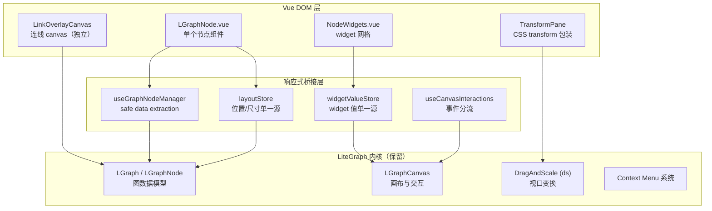
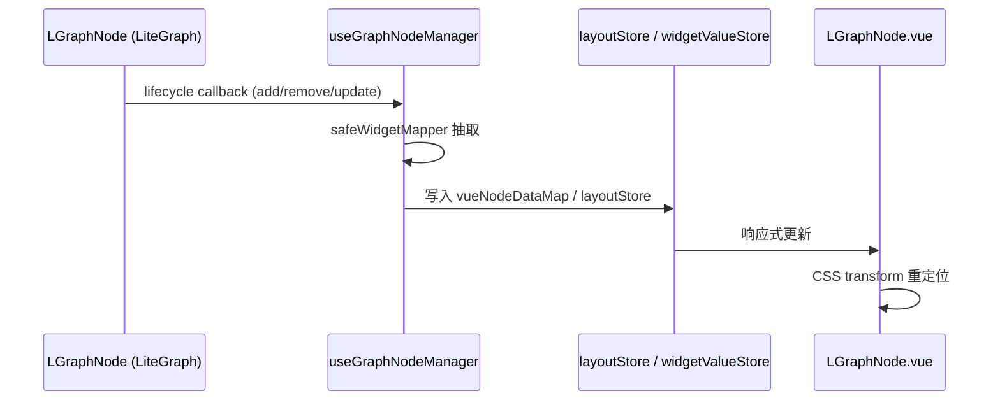
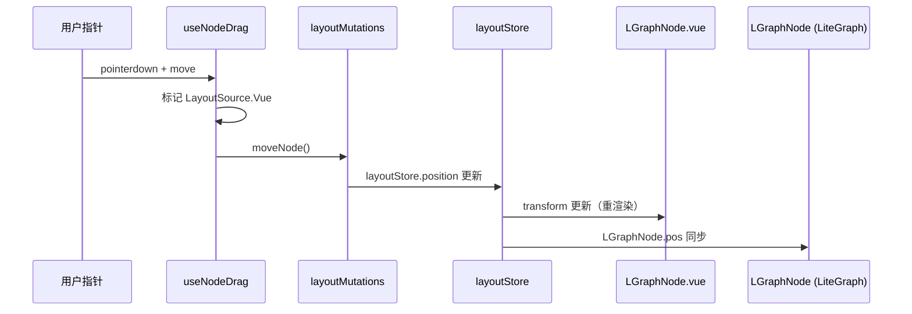
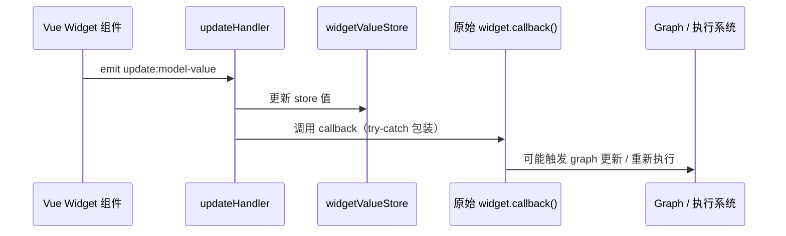

# ComfyUI Nodes 2.0 架构研究报告

> **版本**：v1.1（评审后修订，附分阶段落地评估）  
> **日期**：2026-11-18  
> **定位**：`React-LiteGraph节点面板项目规划.md` 的补充附录  
> **核心结论**：Nodes 2.0 不是"Vue 取代 LiteGraph"，而是**在 LiteGraph 内核之上叠加 Vue DOM 层**的分层架构。
> **v1.1 修订要点**：修正 `setDirty` API 误用；标注二手来源与无来源数据；补充"拖拽主导权"差异；第 7.2 节改为分阶段评估（现在做 / 推迟 / 不做）。

---

## 目录

1. [核心结论与认知修正](#1-核心结论与认知修正)
2. [架构分层](#2-架构分层)
3. [关键模块解析](#3-关键模块解析)
4. [事件流与数据流](#4-事件流与数据流)
5. [三类迁移坑的代码级对策](#5-三类迁移坑的代码级对策)
6. [时间线、动机与真实代价](#6-时间线动机与真实代价)
7. [对自研项目的启示](#7-对自研项目的启示)
8. [参考来源](#8-参考来源)

---

## 1. 核心结论与认知修正

### 1.1 需要修正的表述

常见简化说法"Nodes 2.0 已把节点渲染切到 Vue"容易误导。准确表述是：

> **Nodes 2.0 将"节点主体与 widget 的渲染"迁移到 Vue DOM 覆盖层，但 LiteGraph 仍作为图模型与画布内核完整保留。**

### 1.2 迁移边界（什么变了，什么没变）

| 组件 | Nodes 2.0 之前 | Nodes 2.0 之后 | 变化性质 |
|---|---|---|---|
| 节点主体 | Canvas 逐像素绘制 | **Vue DOM 组件** | ✅ 已迁移 |
| Widget 控件 | Canvas 绘制 + 手写命中区 | **Vue 组件（含 WidgetLegacy 兜底）** | ✅ 已迁移 |
| 连线（noodles） | Canvas 绘制 | **仍在 Canvas（LinkOverlayCanvas）** | ❌ 未迁移 |
| 图数据结构 | `LGraph` / `LGraphNode` | **同一套 `LGraph`** | ❌ 未迁移 |
| 右键菜单 | LiteGraph context menu | **仍触发 LiteGraph 菜单系统** | ❌ 未迁移 |
| 命中测试（连线/端口） | LiteGraph canvas | **仍由 LiteGraph 处理** | ❌ 未迁移 |
| 画布平移缩放 | `LGraphCanvas.ds` | **同一套 `ds`** | ❌ 未迁移 |

**为什么连线不迁移**：官方源码注释明确写 "for performance"——连线数量通常远多于节点数量，用 DOM/SVG 渲染会产生显著开销。

---

## 2. 架构分层

### 2.1 分层结构图



### 2.2 总开关：`LiteGraph.vueNodesMode`

```ts
// 伪代码：官方通过全局 flag 切换渲染路径
if (LiteGraph.vueNodesMode) {
  // TransformPane 为每个视口内节点创建 LGraphNode.vue
  renderVueNodeOverlay()
  // 同时跳过 LGraphCanvas.drawNode() 的节点绘制
} else {
  // 回退到传统 Canvas 绘制节点（legacy 路径）
  lgraphCanvas.drawNode(node)
}
```

**该开关的三重作用**：
1. 兼容回退：自定义节点不兼容时用户可自行切回；
2. 调试对照：坐标/事件问题时可快速判断是 Vue 层还是内核层的问题；
3. 渐进迁移：官方计划先 opt-in → 设为默认 → legacy 最终无人维护。

---

## 3. 关键模块解析

### 3.1 `useGraphNodeManager` — 安全数据抽取

**问题背景**：LiteGraph 的 `LGraphNode` 是高度可变的对象，直接交给 Vue 响应式系统会产生大量不必要的 proxy 开销，且难以追踪变化。

**解决方案**：抽取为安全的 `VueNodeData` 结构再交给组件。

| 字段 | 类型 | 来源 |
|---|---|---|
| `id` | `NodeId` | LGraphNode.id |
| `type` | `string` | 节点类型名 |
| `title` | `string` | 显示标题 |
| `mode` | `number` | ALWAYS / NEVER / BYPASS |
| `flags` | `object` | collapsed / pinned / ghost |
| `widgets` | `SafeWidgetData[]` | 经 `safeWidgetMapper` 抽取 |
| `inputs` / `outputs` | `INodeInputSlot[]` / `INodeOutputSlot[]` | slot 数据 |
| `position` | `Point` | 来自 `layoutStore` |
| `size` | `Size` | 来自 `layoutStore` |

`safeWidgetMapper` 额外处理：widget metadata（name/type/options）、control widget（seed 操作）、slot 索引与连线状态、以及**用 try-catch 包装的 callback**。

### 3.2 `TransformPane` — 坐标一致性

```ts
// 核心：Vue DOM 层的 transform 与 LGraphCanvas.ds 同源
const transform = computed(() => ({
  transform: `translate(${ds.offset[0]}px, ${ds.offset[1]}px) scale(${ds.scale})`,
  transformOrigin: '0 0'
}))
```

节点自身定位则由 `layoutStore` 提供，通过 CSS 变量应用：

```css
.node-container {
  transform: translate(var(--node-x), var(--node-y));
  width: var(--node-width);
  height: var(--node-height);
  z-index: var(--node-z-index);
}
```

### 3.3 `widgetValueStore` — 值单一数据源

组件**不直接读取** LiteGraph widget 对象，而是从 store 读值。收益：

- 避免为复杂 LiteGraph 对象创建 reactive proxy；
- 只追踪真正变化的值；
- 无需遍历 graph 结构取值，支持批量更新。

注册时机：`BaseWidget.setNodeId()` 被调用时，登记初始值、label（若不同于 name）、options（hidden/disabled/advanced）、promoted 标记（子图 widget）。

### 3.4 `layoutStore` + `LayoutSource` — 防同步回环

这是整个桥接层最精妙的设计。由于位置既可被 Vue 拖拽改变，也可被 LiteGraph 程序化改变，双向同步极易产生无限回环。官方用 `LayoutSource` 枚举标记每次变更的来源：

```ts
enum LayoutSource {
  Vue = 'vue',
  LiteGraph = 'litegraph',
  Programmatic = 'programmatic'
}

function applyLayoutMutation(nodeId: NodeId, pos: Point, source: LayoutSource) {
  if (source === LayoutSource.LiteGraph && isDraggingFromVue(nodeId)) return
  layoutStore.setPosition(nodeId, pos, source)
}
```

---

## 4. 事件流与数据流

### 4.1 节点渲染流



### 4.2 节点拖拽流



### 4.3 Widget 值更新流



### 4.4 节点尺寸变更流

```
Resize handle 拖动
  → useNodeResize 直接改 CSS 变量
  → ResizeObserver 感知
  → layoutStore 更新
  → Vue 节点尺寸同步
  → LGraphNode.size 同步
```

### 4.5 事件分流（`useCanvasInteractions`）

```
DOM pointer event
  → shouldHandleNodePointerEvents 计算属性判断
      ├─ true  → Vue 组件/widget 消费
      └─ false → 转发给 LiteGraph canvas
```

**Widget 网格的双阶段处理**：
- **capture 阶段**：把当前节点提到最前（z-index 提升）；
- **bubble 阶段**：若 widget 未消费事件，转发给 canvas。

### 4.6 右键菜单流

```
Vue 捕获右键
  → 更新节点选中态
  → 调用 LiteGraph context menu system 显示菜单
```

> 说明：菜单本身仍是 LiteGraph 的，Vue 只负责拦截与转发。

---

## 5. 三类迁移坑的代码级对策

以下三类问题来自 rgthree-comfy PR #727（一个真实自定义节点插件的 Nodes 2.0 适配过程），具有普遍代表性。**对策按 React + LiteGraph 技术栈给出。**

### 5.1 坑一：坐标系不匹配（点击失效）

**根因**：`pointerdown` 时坐标是 mini-canvas 局部坐标，`pointerup` 时坐标变成 node 局部坐标（偏移了标题栏与上方 widget）。在第二阶段再做边界复检时，两个坐标系不匹配，导致判定永远失败。

**官方/社区修复**：移除 `pointerup` 时的边界复检——命中区数组本就在 `pointerdown` 通过校验后才填充，二次校验是冗余的。

**对你的项目的对策：建立统一坐标转换函数，所有指针事件只走这一条路径。**

```ts
// coords.ts — 唯一坐标真相源
interface Viewport { x: number; y: number; zoom: number }

/** 屏幕坐标 → 图模型坐标（唯一入口） */
export function screenToGraph(
  clientX: number,
  clientY: number,
  canvasRect: DOMRect,
  vp: Viewport
): Point {
  return {
    x: (clientX - canvasRect.left - vp.x) / vp.zoom,
    y: (clientY - canvasRect.top - vp.y) / vp.zoom,
  }
}

/** 图模型坐标 → 节点局部坐标 */
export function graphToNodeLocal(point: Point, nodePos: Point): Point {
  return { x: point.x - nodePos[0], y: point.y - nodePos[1] }
}
```

```tsx
// 命中判定：down/up 都用同一坐标系，禁止二次复检
function useHitArea(onClick: () => void) {
  const armed = useRef(false)

  return {
    onPointerDown: (e: React.PointerEvent) => {
      const p = screenToGraph(e.clientX, e.clientY, e.currentTarget.getBoundingClientRect(), vp)
      armed.current = hitTest(p)          // 只在 down 时校验
    },
    onPointerUp: () => {
      if (armed.current) onClick()        // up 只消费，不重新校验
      armed.current = false
    },
  }
}
```

**规则**：任何坐标系转换都必须调用 `screenToGraph`，禁止在组件内手写 `(clientX - offset) / zoom`。

> **参数语义澄清（重要）**：上式的 `vp.x / vp.y` 是**屏幕像素偏移**，来自 `LGraphCanvas.ds.offset`，不是图坐标。调用方传入的 `viewport` 必须是已同步的值；若把图坐标误当作 `vp` 传入，公式会静默算错。本项目 `store.viewport = { x, y, zoom }` 与 `ds` 的映射为 `x = offset[0], y = offset[1], zoom = scale`。

### 5.2 坑二：重绘模型差异（widget 不刷新）

**根因**：LiteGraph 每帧重绘 canvas，所以自定义 widget 的 `draw()` 天然被持续调用；Vue 渲染器只在 `widget.triggerDraw()` 被调用时才重绘。数据变更后若不显式触发，界面不更新。

**对你的项目的对策：建立显式的失效通道，把"数据变更"与"重绘"解耦。**

```ts
// useInvalidation.ts — 统一失效机制
type InvalidateFn = () => void

export function useInvalidation(nodeId: string) {
  const canvasRef = useGraphContext()  // 需返回 LGraphCanvas 实例引用
  const rafRef = useRef<number | null>(null)

  const invalidate = useCallback(() => {
    if (rafRef.current !== null) return       // 合并同一帧内的多次失效
    rafRef.current = requestAnimationFrame(() => {
      rafRef.current = null
      // 注意：LGraphNode 没有 setDirty()，只有 setDirtyCanvas(fg, bg?)；
      // 画布级失效用 LGraphCanvas.setDirty(fg, bg?)。0.17.2 已核实。
      canvasRef.current?.setDirty(true)
      // 若 widget 内含 mini-canvas，需显式重绘它
      widgetRegistry.get(nodeId)?.triggerDraw?.()
    })
  }, [canvasRef, nodeId])

  return invalidate
}
```

```tsx
// 所有数据变更入口都调用 invalidate
function NumberWidget({ nodeId, widget }) {
  const invalidate = useInvalidation(nodeId)
  const setWidgetValue = useWidgetStore(s => s.setValue)

  const onChange = (v: number) => {
    setWidgetValue(nodeId, widget.id, v)   // ① 更新状态
    widget.callback?.(v)                    // ② 触发业务逻辑
    invalidate()                            // ③ 显式失效（不可省略）
  }
  return <input type="number" onChange={e => onChange(+e.target.value)} />
}
```

**规则**：在 `Renderer` 接口中强制定义 `invalidate(nodeId)`，任何修改节点数据的 Action 都必须调用它。这样即使未来从 Canvas 切到 WebGPU 渲染，失效语义也不变。

> **对本项目的适用性（v1.1 评估）**：`IRenderer` 是 ComfyUI 前端内部结构，本项目**没有**该接口，照搬属于过度设计。**现在做**：沿用已有的 rAF 合并同步（`LiteGraphCanvas.tsx` 的 `scheduleFullSync` / `syncNodePositions`），并把所有写回 `graph` 的入口统一走它；**不做**：新增 `Renderer` 抽象。若未来真的切换渲染器，再抽象不迟。

### 5.3 坑三：`name` / `label` 语义差异（端口标签消失）

**根因**：自定义节点用 `addOutput("", "")` 创建 slot，随后 `setOutputs()` 只设置 `type` 和 `label`，未设置 `name`。LiteGraph 的 canvas 渲染器在 name 为空时会回退显示 label，所以从未暴露问题；Vue 的 `OutputSlot.vue` 严格按 name 渲染，name 为空即隐藏标签。

**对你的项目的对策：在数据模型中统一"显示文本"的解析规则，不依赖渲染器兜底。**

```ts
// port.ts — 单一显示文本解析函数
interface PortDef {
  name: string
  label?: string
  type: PortType
}

/** 唯一的端口显示文本解析规则 */
export function getPortDisplayText(port: PortDef): string {
  // 规则：name 优先，label 兜底，最后用 type
  return port.name?.trim() || port.label?.trim() || port.type
}
```

```tsx
// 所有渲染路径共用同一函数
function PortLabel({ port }: { port: PortDef }) {
  return <span className="port-label">{getPortDisplayText(port)}</span>
}
```

```ts
// 写入侧同步规范化：创建 slot 时就补齐 name
function setOutputs(node: LGraphNode, outputs: OutputSpec[]) {
  node.outputs = outputs.map(o => ({
    ...o,
    name: o.name || o.label || o.type,   // 关键：不让 name 留空
    label: o.label || o.name || o.type,
  }))
}
```

**规则**：`getPortDisplayText()` 是端口文本的唯一来源；写入时保证 `name` 非空。Canvas 渲染路径同样调用该函数，杜绝两套渲染器行为分叉。

> **对本项目的适用性（v1.1 评估）**：本项目的 `PortDef.name` 是必填 `string`，且端口统一通过 `addInput(name, type)` / `addOutput(name, type)` 创建，"name 留空"的前提不成立。**现在做**：保留"写入侧保证 name 非空"的校验规则，并在 React 端口标签渲染处统一读同一字段；**不做**：新增 `label` 字段和 `getPortDisplayText()` 抽象——为一个不存在的场景增加字段和函数，收益低于维护成本。

### 5.4 三类坑的共性

| 坑 | 表层现象 | 根本原因 | 统一对策 |
|---|---|---|---|
| 坐标系不匹配 | 点击无响应 | 同一逻辑点存在多个坐标系表示 | 单一坐标转换入口 |
| 重绘模型差异 | 数据变了界面没变 | "数据变更"与"重绘"耦合在渲染器实现里 | 显式 invalidate 通道 |
| name/label 差异 | 标签消失 | 显示文本规则散落在各渲染器兜底逻辑中 | 单一显示文本解析函数 |

**一句话总结**：三类坑的根因都是**"同一语义存在多个实现来源"**。对策统一为**"建立单一真相源 + 强制所有路径调用"**。

---

## 6. 时间线、动机与真实代价

> **来源等级说明（v1.1 补充）**：本节时间线与社区反馈以二手来源为主。官方文档与公告（表 8 中标注"官方"的两条）可信度较高；Reddit 镜像站、社区资讯站、讨论汇总仅作旁证，具体日期、版本号与引用语未逐条核对一手来源，不应作为决策的唯一依据。

### 6.1 时间线

| 时间 | 事件 |
|---|---|
| 2025-07 | Nodes 2.0 进入 beta |
| 2025-12-05 | 官方发布《尝试 Nodes 2.0 并帮助我们改进 ComfyUI》 |
| 2026-02 ~ 04 | 社区反馈集中爆发；rgthree 等主流插件声明不适配 |
| 2026-05-22 | ComfyOrg 在 Reddit 官方更新：承认"接受度参差"，说明渐进迁移计划 |
| 2026-08-28 | 前端 v1.53.4 修复 Nodes 2.0 转换控件被隐藏等问题 |
| 2026-11（当前） | 仍为 opt-in（Settings → Rendering → Nodes 2.0） |

### 6.2 官方计划（2026-05 官方帖）

1. 当前：Nodes 2.0 保持可选启用；
2. 中期：设为默认，legacy 模式仍可用；
3. 长期：legacy 模式无人维护，可能逐渐失效；
4. **新的前端特性只在 Nodes 2.0 上线**。

官方明确表示没有固定截止日期，优先给生态适配时间。

### 6.3 已交付能力（官方列举）

曲线编辑器、直方图显示、实时裁剪 UI、前后对比滑块、图像处理节点（色彩校正/胶片颗粒/色差/锐化/色阶）、实时 shader 节点与子图蓝图、节点内内联错误与状态徽章。

规划中：子图实时执行预览、并行节点执行与实时反馈。

### 6.4 真实代价（社区反馈）

| 类别 | 具体反馈 |
|---|---|
| 性能 | 大工作流 FPS 下降、拖拽/平移卡顿、连线延迟或瞬移、CPU 占用飙高 |
| 兼容性 | 部分自定义节点需适配；rgthree 作者明确拒绝，称"运行慢得多" |
| 可用性 | 节点占用空间变大、常用快速按钮被移除、下拉框尺寸与滚动不便、文本布局间距异常 |
| 开发体验 | 缺少开发者文档与迁移规范，插件作者被迫逆向工程（rgthree PR 历经 4 个月反复 rebase） |
| 其他 | 极端缩放/超大工作流视觉问题、移动端体验差、可访问性问题 |

### 6.5 性能说法的判断（v1.1 修订）

> **v1.1 更正**：原稿写有"第三方资料称 200+ 节点下 Vue 渲染比 LiteGraph 快约 2 倍"，但参考来源表中**没有任何来源支撑该数字**，属于无来源数据，已删除。

官方明确表示性能"仍在优化以达到 Canvas 级别"，且社区大量反馈相反。

**可靠结论**：DOM 方案在**控件丰富度与开发效率**上占优；在**超大图渲染性能**上，官方与社区口径均指向"未超越 Canvas"，但缺少可核查的基准测试数据，因此不作定量判断。视口剔除与批量更新仍是必需项，而非可选项。

---

## 7. 对自研项目的启示

### 7.1 架构选型被官方验证

项目规划文档推荐的"模式 B：LiteGraph 管图模型/连线/画布交互，React 渲染节点主体 DOM"与 Nodes 2.0 实际架构几乎同构。差异点：

| 维度 | 本项目（当前 Spike / 规划） | ComfyUI Nodes 2.0 |
|---|---|---|
| UI 框架 | React + Zustand | Vue 3 + Pinia |
| 视口同步 | 单一 `viewport` 状态 | `TransformPane` + `ds` |
| 连线渲染 | Canvas（LiteGraph 原生） | `LinkOverlayCanvas` |
| 节点剔除 | 规划中（LOD + 视口过滤），**Spike 未实现** | 视口内节点才挂载 |
| 防回环 | 当前不需要（见 7.2 评估） | `LayoutSource` |
| **拖拽主导权（关键差异）** | **LiteGraph 主导**：拖动由 canvas 处理，React 只读镜像 | **Vue 主导**：`useNodeDrag` 处理并主动写回 `LGraphNode.pos` |

> **关键差异说明（v1.1 补充）**：拖拽主导权的不同决定了 "防回环" 是否必要。Nodes 2.0 由 Vue 主动写 `node.pos`，才需要 `LayoutSource`；本项目由 LiteGraph 单向写、React 仅镜像，当前不存在双向回环。

### 7.2 三项设计的分阶段评估（v1.1 重写）

原稿笼统建议"三项都补进规划文档"。结合本项目**已完成的 Spike** 与**LiteGraph 主导拖拽**的现实，逐项评估如下：

| 设计 | 结论 | 时机 | 理由 |
|---|---|---|---|
| 端口显示文本单一规则 | **现在做（简化版）** | 阶段 2 做节点库/端口渲染时 | 规则本身有价值且成本极低；但不新增 `label` 字段与 `getPortDisplayText()` 抽象，改为"写入侧保证 `name` 非空 + 渲染侧统一读 `name`"。见 5.3 评估。 |
| `LayoutSource` 来源标记 | **推迟** | 阶段 2，一旦出现 React 侧标题栏拖拽 / widget 改尺寸等反向写 `node.pos` 的路径再引入 | 当前拖拽由 LiteGraph 主导、React 只读镜像，不存在回环。提前引入枚举和守护逻辑是无收益的复杂度。见 7.1 关键差异。 |
| 显式 `invalidate` 通道 | **不做 `IRenderer` 抽象；保留轻量机制** | 现在沿用已有实现 | 项目没有 `IRenderer` 接口；已用 `scheduleFullSync` / `syncNodePositions` 的 rAF 合并实现同样的"显式失效"语义。且原稿示例的 `node.setDirty()` API 不存在（见 5.2 更正）。 |

**一句话结论**：三项里**只有"端口文本规则"现在落地（且要简化）**；其余两项在当前架构下要么推迟、要么用已有机制等价替代。这体现了报告自己的原则——"同一语义不要有多个实现来源"，但**反过来也适用**：不要为不存在的场景提前建立机制。

### 7.3 保留双渲染路径开关

> 以下是**原稿建议**，v1.1 评估结论为**不实现**，保留原文仅作决策记录。

在规划文档的阶段 0 Spike 中增加一个全局 flag `USE_DOM_NODES`：

```ts
const USE_DOM_NODES = import.meta.env.VITE_USE_DOM_NODES !== 'false'
```

这既是兼容回退方案，也是调试坐标对齐问题的对照手段。官方自己也用 `vueNodesMode` 做了同样的事。

> **v1.1 评估：不新增该 flag**。本项目阶段 0 已完成，并且**已经有等价开关**——`LiteGraphCanvas.tsx` 覆写 `drawNode` 决定"跳过原生节点绘制、走 React 覆盖层"；去掉覆写即回到 legacy 的 Canvas 绘制路径。再加一个 env flag 会引入两条需要同步维护的渲染路径，收益已被覆盖。"保留双路径作为对照手段"的**思路**已采纳，无需额外实现。

### 7.4 理性看待迁移成本

Nodes 2.0 的经验表明：**Canvas → DOM 的迁移成本主要在"交互语义对齐"，而非"视觉还原"**。如果你的项目从一开始就采用混合架构（而非先 Canvas 后迁移），这三类坑可以在设计阶段规避，成本会显著低于 ComfyUI 的迁移路径。

---

## 8. 参考来源

| 来源 | 类型 | 等级 | 用途 |
|---|---|---|---|
| [ComfyUI 官方文档：Nodes 2.0](https://docs.comfy.org/interface/nodes-2) | 官方 | A | 迁移说明、当前状态、已知问题 |
| [ComfyUI.org：尝试 Nodes 2.0 并帮助我们改进](https://comfyui.org/zh/comfyui-node-2-0) | 官方公告 | A | 迁移动机、社区反馈回应、路线图 |
| [ComfyOrg 官方 Reddit 更新（2026-05-22）](https://redlib.highda.space/r/comfyui/comments/1tkqq36/an_update_on_nodes_20_from_comfy_org/) | 官方声明（经 Reddit 镜像） | B | 时间线、已交付能力、渐进迁移计划 |
| [DeepWiki：Vue Node Components](https://deepwiki.com/mg-org-2/sub-251027/14.3-vue-node-components) | 源码解析 | B | 架构分层、模块职责、事件流 |
| [rgthree-comfy PR #727](https://github.com/rgthree/rgthree-comfy/pull/727) | 社区实践（一手 PR） | B | 三类迁移坑的根因与修复 |
| [ComfyUI 日报 2026-08-28](https://service-yun.com/daily/2026-08-28.html) | 社区资讯站 | C | v1.53.4 修复记录（未核对一手） |
| [奇绩创坛：Nodes 2.0 测试更新](https://news.miracleplus.com/share_link/131936) | 社区讨论汇总 | C | 社区七类争议点（未核对一手） |

> **等级含义**：A = 官方一手；B = 源码解析/一手 PR/官方声明镜像，可信但需谨慎；C = 二手汇总，仅供旁证，不单独作为决策依据。

> **置信度说明（v1.1 更新）**：架构分层与模块职责来自 DeepWiki 对 `ComfyUI_frontend` 源码的解析（B 级），可信度较高；`vueNodeDataMap` 的具体结构在文档中未直接定义，本报告未对其作断言；第 6 节时间线与社区反馈多为 B/C 级二手来源，已在节首标注；性能结论仅作定性判断，原稿无来源的"2 倍"数据已删除（见 6.5）；第 5 节代码示例中的 API 已按 `@comfyorg/litegraph@0.17.2` 的 `.d.ts` 校正。

---

> **配套文档**：`React-LiteGraph节点面板项目规划.md`（主文档）
