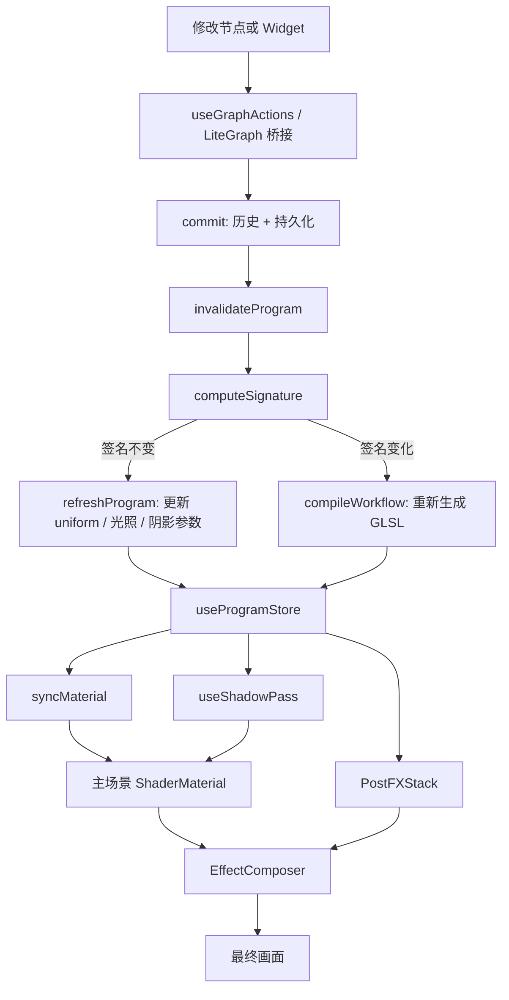

# 单一场景光照与阴影算法切换方案

> 文档状态：v1.1（阶段 0–4、阴影工程质量项与屏幕空间反射 SSR 已落地）  
> 日期：2026-11-20  
> 适用范围：`单一场景内切换不同光照 / 阴影 / 后处理算法`  
> 当前状态：WebGL/GLSL 主链路已实现并通过单元 / E2E 验证；真正的 WebGPU path tracing 需要重写渲染器，仍属于独立 Spike。

---

## 实施结果

| 阶段 | 内容 | 状态 | 验证 |
|---|---|---|---|
| 阶段 0 | 阴影 pass 缓存修复、共享阴影 GLSL、按光源应用阴影 | 已完成 | compiler / signature 单测，`verify:3d` |
| 阶段 1 | Lambert / Blinn-Phong 着色模型、BRDF / lighting chunk 拆分 | 已完成 | compiler 单测，`verify:3d` |
| 阶段 2 | PCF / PCSS 方法切换、PCSS 参数 uniform 化 | 已完成 | compiler / signature 单测，`verify:3d` |
| 阶段 3 | VSM moments、模糊、Chebyshev、能力检测与 PCF 回退 | 已完成 | compiler / signature 单测，`verify:3d` |
| 阶段 4 | 自定义 SSAO Effect、NormalPass / Depth 接入、深度双边权重与 WebGL2 检测 | 已完成 | `verify:3d` shader 与链验证 |
| 阴影工程 | `ShadowPassScheduler` / RenderTarget 工具、动态光源相机、normalBias | 已完成 | compiler 单测，`verify:3d` |
| 阶段 5a | 屏幕空间反射 SSR（深度 / 法线光线步进 Effect） | 已完成 | `verify:3d` shader 与链验证 |
| 阶段 5b | WebGPU path tracing（BVH / accumulation / denoiser） | 未开始 | 需重写渲染器，独立 Spike |

当前验证基线：`npm test` 57/57，`npm run build` 通过，`npm run verify:3d` 47/47。

---

## 1. 背景与结论

当前项目已经具备一条可用的“节点图 → GLSL → R3F 预览 → 后处理”链路：

- `src/graph/nodeDefinitions.ts` 定义节点、端口和 Widget；
- `src/shader/compiler.ts` 把 `WorkflowUI` 编译成 `CompiledProgram`；
- `src/shader/glsl/` 提供 BRDF / lighting / PCF / PCSS / VSM 等 GLSL 生成模块；
- `src/viewer/passes/ShadowPassScheduler.tsx` 统一调度深度 pass、VSM moments / blur 与动态光源相机；
- `src/postfx/PostFXStack.tsx` 按节点链顺序执行后处理，SSAO 与 SSR 使用自写 Effect。

在“单一场景内切换算法”这个范围内，结论是：

| 方向 | 结论 |
|---|---|
| Lambert / Blinn-Phong / PBR / Unlit 切换 | 可行，优先做 |
| PCF / PCSS / VSM 阴影切换 | 可行，但需要先重构阴影 pass |
| SSAO 自写 | 可行，建议放后处理阶段单独做 |
| 真光线追踪 / path tracing | 当前 WebGL2 + GLSL 架构不合适，不纳入本阶段 |

本阶段不建议为每种算法新建一类节点。更稳妥的方式是：

- 在 `material/Surface` 上用 `shading` 枚举选择 Lambert / Blinn-Phong / PBR / Unlit；
- 在 `render/Shadow` 上用 `method` 枚举选择 PCF / PCSS / VSM；
- 编译器根据这些枚举生成不同 shader 变体和不同 render pass；
- 节点数量保持基本稳定，减少序列化、Inspector 和连接校验的改动。

---

## 2. 范围定义

### 2.1 In Scope

1. 单一 `scene/Root`、单一 Mesh、单一材质。
2. 通过节点 Widget 在以下算法间切换：
   - 表面着色：Unlit / Lambert / Blinn-Phong / PBR；
   - 阴影：PCF / PCSS / VSM；
   - 后处理：保留现有 SSAO，后续可选自写版本。
3. 切换算法时自动重编译 shader。
4. 调参时尽量只刷新 uniform，不重编译。
5. 保持现有工作流 schema v2 兼容。

### 2.2 Out of Scope

1. 多个 `scene/Root` 同时渲染。
2. 多个 Mesh 分别绑定不同材质节点。
3. glTF 多材质槽。
4. 通用 GLSL 文本编辑器。
5. WebGPU / WGSL / 硬件光追 / path tracing。
6. 延迟渲染管线。

---

## 3. 当前架构与渲染管线

### 3.1 分层结构

```text
节点图编辑层
  graph/nodeDefinitions.ts
  graph/nodeRegistry.ts
  graph/useLiteGraphBridge.ts
        │
        ▼
编译层
  shader/signature.ts
  shader/compiler.ts
  shader/emitters/*
  shader/glsl/chunks.ts
        │
        ▼
渲染层
  viewer/Viewport3D.tsx
  viewer/SceneRoot.tsx
  viewer/material.ts
  viewer/ModelAsset.tsx
        │
        ▼
后处理层
  postfx/chain.ts
  postfx/PostFXStack.tsx
```

### 3.2 当前数据流



### 3.3 关键现状

1. `compileWorkflow()` 是纯函数，输出 `CompiledProgram`，当前材质模型只有 `pbr | unlit`。
2. `computeSignature()` 只把终端可达节点的 `codeAffectingWidgets` 纳入签名。
3. `material/Surface.shading` 已经是 `codeAffectingWidgets`，切换 PBR / Unlit 会重编译。
4. 光照以定长数组传给 shader，最多 3 盏灯。
5. 阴影由 `SceneRoot.tsx` 手工渲染 depth pass 到 `DepthTexture`。
6. 阴影采样目前是 3×3 PCF，且 PBR 片元和地面片元各写了一份。
7. SSAO 目前由 `@react-three/postprocessing` 提供，不是自写 shader。
8. R3F Canvas 使用 WebGL，不具备原生硬件光追能力。

---

## 4. 关键约束

### 4.1 单一材质模型

当前 `CompiledProgram` 的结构是：

```ts
shading: 'pbr' | 'unlit'
pbr: { vertexShader: string; fragmentShader: string } | null
unlit: { vertexShader: string; fragmentShader: string } | null
```

`createProgramMaterial()` 也只在这两个 shader 中二选一。要支持 Lambert / Blinn-Phong，需要先扩展这个联合类型和 shader 选择逻辑。

### 4.2 新算法开关必须影响签名

如果新增 Widget：

- `material/Surface.method` 或 `shading`
- `render/Shadow.method`
- `postfx/SSAO.mode`

只要它会改变 GLSL 结构或 render pass，就必须加入 `codeAffectingWidgets`。否则签名不变，编译器只会走 `refreshProgram()`，不会重新生成 shader。

### 4.3 阴影不是一个纯片元问题

Lambert / Blinn-Phong 主要改 BRDF，属于片元 shader 变体。

但 PCSS / VSM 不同：

| 方法 | 是否需要新增 Pass / RenderTarget | 说明 |
|---|---:|---|
| PCF | 否 | 当前已有 depth texture，只需采样 |
| PCSS | 否 | 增加 blocker search 和可变半径 PCF，仍是采样阶段变化 |
| VSM | 是 | 需要 moments map、模糊 pass、Chebyshev 采样 |
| 点光阴影 | 是 | 需要 cubemap depth，当前不支持 |

因此 VSM 之前必须先抽出 pass 调度层。

### 4.4 现有阴影实现存在技术债

当前阴影 pass 存在几个需要先修的问题：

1. 只支持第一盏方向光投影。
2. 光源相机固定正交范围 `[-3, 3]`，没有根据场景或光源拟合。
3. `useShadowPass()` 的缓存 key 没包含光源方向，方向变化时 depth pass 可能不刷新。
4. 同一个 shadow 因子被所有非环境光共用，点光会被方向光阴影错误乘暗。
5. PBR 片元和地面片元重复实现了阴影采样逻辑。

这些问题不修，继续加 PCSS / VSM 会放大不一致性。

---

## 5. 算法可行性评估

### 5.1 表面着色

| 算法 | 可行性 | 预估工期 | 改造范围 |
|---|---:|---:|---|
| Unlit | 已实现 | - | 当前已有 |
| Lambert | 高 | 1 人日 | 新增 BRDF 分支，复用灯光 uniform |
| Blinn-Phong | 高 | 1–2 人日 | 新增 `shininess` / `specularStrength` uniform |
| PBR | 已实现基础版 | 2–5 人日 | 若增强，需要 IBL、法线贴图、tone mapping |
| 完整 PBR | 中 | 1–2 周 | 需要材质贴图语义、BRDF LUT、色彩空间管理 |

推荐第一阶段实现顺序：

```text
Unlit / PBR 已有
  → Lambert
  → Blinn-Phong
  → PBR 质量增强
```

### 5.2 阴影

| 算法 | 可行性 | 预估工期 | 改造范围 |
|---|---:|---:|---|
| 硬阴影 | 已有基础 | - | 当前 depth pass |
| 3×3 PCF | 已实现 | - | 当前采样逻辑 |
| PCF 增强 | 高 | 1–2 人日 | 修 key、bias、normalBias、光源相机 |
| PCSS | 中高 | 3–6 人日 | blocker search + 可变 penumbra PCF |
| VSM | 中 | 4–7 人日 | moments RT + blur + Chebyshev + 能力检测 |
| 点光阴影 | 中低 | 5–10 人日 | cubemap depth pass，不建议本轮做 |

推荐阴影实现顺序：

```text
修现有 PCF 技术债
  → 支持 method=pcf/pcss
  → 抽 RenderPass 调度
  → 支持 VSM
```

### 5.3 后处理

| 算法 | 可行性 | 说明 |
|---|---:|---|
| 现有库 SSAO | 高 | 已接入，但依赖库实现 |
| 自写 SSAO | 中 | 需要 Normal/Depth、采样核、双边模糊 |
| 屏幕空间 SSR | 中低 | 需要 G-buffer、ray march、denoise，效果受限 |
| 真光追 | 低 | 需要 WebGPU 或全新增渲染器，不属于本阶段 |

---

## 6. 推荐设计

### 6.1 着色模型设计

建议把 `shading` 从：

```ts
type ShadingModel = 'pbr' | 'unlit'
```

扩展为：

```ts
type ShadingModel = 'unlit' | 'lambert' | 'blinnPhong' | 'pbr'
```

`material/Surface` 的 `shading` Widget 增加：

```ts
['unlit', 'lambert', 'blinnPhong', 'pbr']
```

Blinn-Phong 额外参数：

- `shininess`
- `specularStrength`

这些参数不默认改变 GLSL 结构，可以作为 uniform。首次实现时也可以先做成固定常量，后续再暴露 Widget。

### 6.2 GLSL 组织方式

不要为每种模型复制完整 fragment shader。建议把片元着色器拆成：

```text
共用 varying / uniform
  +
surface expression
  +
light loop
  +
BRDF(model)
  +
shadow(model)
  +
output
```

推荐新增模块：

```text
src/shader/glsl/
  chunks.ts
  lighting.ts
  brdf.ts
  shadow.ts
```

职责：

| 文件 | 职责 |
|---|---|
| `lighting.ts` | 生成灯光循环、光类型分支、衰减 |
| `brdf.ts` | 生成 Lambert / Blinn-Phong / GGX BRDF |
| `shadow.ts` | 生成 PCF / PCSS / VSM 采样 |
| `chunks.ts` | 组装 vertex / fragment shader 模板 |

这样可以避免 PBR、地面、未来其他材质重复维护同一份阴影逻辑。

### 6.3 编译产物设计

短期最小改动：

```ts
interface CompiledProgram {
  shading: ShadingModel
  shaderSource: {
    vertexShader: string
    fragmentShader: string
  } | null
}
```

为保持兼容，可暂时保留 `pbr` / `unlit` 字段，稳定后再移除。

中长期建议：

```ts
interface CompiledProgram {
  shading: ShadingModel
  shaderSource: ShaderSource | null
  renderPlan: {
    shadowPasses: ShadowPassDescriptor[]
  }
}
```

`ShadowPassDescriptor` 示例：

```ts
interface ShadowPassDescriptor {
  lightIndex: number
  method: 'pcf' | 'pcss' | 'vsm'
  mapSize: 1024 | 2048
  bias: number
  normalBias: number
  lightSize: number
}
```

### 6.4 阴影 Pass 调度

建议把当前 `useShadowPass()` 从 `SceneRoot.tsx` 抽出来：

```text
src/viewer/passes/
  PassScheduler.tsx
  ShadowPass.ts
  PcfShadowPass.ts
  PcssShadowPass.ts
  VsmShadowPass.ts
  targetPool.ts
```

`PassScheduler` 职责：

1. 根据 `renderPlan.shadowPasses` 创建 RenderTarget。
2. 处理 RenderTarget 的复用和释放。
3. 避免 framebuffer ↔ texture feedback loop。
4. 在 demand 模式下用 `requestFrame()` 请求重绘。
5. 支持能力检测和 fallback。

---

## 7. 实施阶段

### 阶段 0：修基础问题

目标：为后续算法切换建立稳定基线。

内容：

1. 修阴影 pass 缓存 key，加入光源方向 / 位置。
2. 阴影采样 GLSL 抽成共享函数。
3. 明确 shadow 只作用于对应光源，避免点光被方向光阴影乘暗。
4. 补现有 PCF 的单测和 `verify:3d` 用例。

预估：1–2 人日。

### 阶段 1：Lambert / Blinn-Phong

目标：完成表面着色模型的节点化切换。

内容：

1. 扩展 `ShadingModel`。
2. `material/Surface` 增加算法选项与 Blinn-Phong 参数。
3. 新增 `brdf.ts`，抽出 BRDF chunk。
4. `compiler.ts` 根据模型生成 fragment shader。
5. `material.ts` 适配新的 shaderSource。
6. compiler 单测覆盖四种模型。
7. `verify:3d` 验证切换时 programHash 改变、调参时不变。

预估：2–4 人日。

### 阶段 2：PCF / PCSS 切换

目标：阴影算法可以在节点上切换，PCSS 可实际运行。

内容：

1. `render/Shadow` 增加 `method: pcf | pcss`。
2. `method` 加入 `codeAffectingWidgets`。
3. 新增 `shadow.ts`，生成 PCF / PCSS 采样代码。
4. 增加 `lightSize` / `blockerSamples` / `pcfSamples` 等参数。
5. 保留 PCF 作为默认与 fallback。
6. 验证 PCSS 性能与画面稳定性。

预估：3–6 人日。

### 阶段 3：VSM

目标：支持 VSM 阴影，并对不支持设备自动回退。

内容：

1. 抽 `PassScheduler`。
2. 实现 moments RenderTarget。
3. 实现横纵高斯模糊。
4. 实现 Chebyshev 采样。
5. 加浮点纹理 / 线性过滤能力检测。
6. 增加 light bleeding 修正。
7. 处理 RenderTarget 生命周期与 context loss。

预估：4–7 人日。

### 阶段 4：自定义 SSAO

目标：把 SSAO 从库封装替换为可自写、可调的 shader 效果。

内容：

1. 准备 NormalPass / DepthPass。
2. 编写 SSAO Effect 或自定义 Composer Pass。
3. 保持现有 `postfx` 单向链顺序。
4. 不支持时回退库版。
5. 补 Firefox 能力检测。

预估：4–8 人日。

---

## 8. 文件改动清单

### 必改

| 文件 | 改动 |
|---|---|
| `src/graph/nodeDefinitions.ts` | 增加 shading / shadow method / Blinn-Phong 参数 |
| `src/shader/compiler.ts` | 输出 shader variant 和 renderPlan |
| `src/shader/signature.ts` | 确认新 method 参数参与签名 |
| `src/shader/emitters/surface.ts` | 扩展 `SurfaceEmit.shading` |
| `src/shader/glsl/chunks.ts` | 拆分 BRDF / lighting / shadow 模板 |
| `src/viewer/material.ts` | 不再硬编码 PBR / Unlit 二选一 |
| `src/viewer/SceneRoot.tsx` | 接 shadow pass 调度，修方向缓存 bug |

### 新增建议

| 文件 | 用途 |
|---|---|
| `src/shader/glsl/brdf.ts` | Lambert / Blinn-Phong / GGX |
| `src/shader/glsl/lighting.ts` | 灯光循环与衰减 |
| `src/shader/glsl/shadow.ts` | PCF / PCSS / VSM 采样 |
| `src/viewer/passes/PassScheduler.tsx` | 离屏 Pass 调度 |
| `src/viewer/passes/ShadowPass.ts` | 阴影 pass 抽象 |
| `src/viewer/passes/targetPool.ts` | RenderTarget 复用与释放 |

### 测试

| 文件 | 改动 |
|---|---|
| `tests/compiler.test.ts` | 新增多着色模型断言 |
| `tests/signature.test.ts` | 验证 method 变化触发签名变化 |
| `scripts/verify-3d.mjs` | 新增算法切换、调参、阴影与性能用例 |

---

## 9. 验收口径

### 9.1 编译验收

1. Unlit / Lambert / Blinn-Phong / PBR 都能生成完整 shader。
2. `shading` 改变时 `programHash` 改变。
3. `shininess` 等 uniform 参数改变时 `programHash` 不变。
4. `shadow.method` 改变时 `programHash` 或 renderPlan 改变。
5. 编译失败时保留上一帧画面，并在节点和 Inspector 标红。

### 9.2 渲染验收

1. 同一组灯光下，Lambert / Blinn-Phong / PBR 呈现明显差异。
2. PCF / PCSS / VSM 阴影均能开启和关闭。
3. 改变平行光方向后，阴影方向立即更新。
4. 点光不应被方向光阴影错误乘暗。
5. VSM 不支持时自动回退到 PCF，不出现黑屏或 shader 错误。
6. 上下文丢失恢复后能重新创建 shader 和 RenderTarget。

### 9.3 性能验收

1. 默认场景稳定 60fps。
2. PCSS 只在主方向光上启用，不做三灯全开。
3. VSM 的临时 RenderTarget 在切换算法后正确释放。
4. demand 模式下参数变化能通过 `requestFrame()` 正确出帧。

---

## 10. 兼容性策略

1. 新 Widget 追加在定义末尾，避免改变已有 `widgets_values` 顺序。
2. 所有读取新 Widget 的地方必须有默认值。
3. 老工作流缺少新 Widget 值时，按默认算法处理：
   - `shading` 默认 `pbr`；
   - `shadow.method` 默认 `pcf`。
4. 保持 schema v2，不急着升 schema v3。
5. `CompiledProgram` 可短期保留 `pbr` / `unlit` 字段，降低回归风险。
6. 若未来要支持多 Root / 多材质，再单独升级 schema。

---

## 11. 风险与应对

| 风险 | 应对 |
|---|---|
| shader 分支过多，维护成本高 | 共用 BRDF / shadow chunk，避免整份复制 |
| PCSS 采样数过高 | 限制单灯启用，暴露采样数参数并设保守默认 |
| VSM 浮点 RT 不兼容 | 运行时能力检测，自动回退 PCF |
| VSM light bleeding | 当前使用固定 0.15 修正，尚未暴露参数 |
| 阴影 pass 资源泄漏 | 当前已统一 dispose；RenderTarget 池化仍待后续 |
| 方向变化阴影不更新 | 已修 pass 缓存 key，E2E 覆盖 |
| 老工作流参数错位 | 新 Widget 追加末尾，读取端提供默认值 |
| 画质对比不明显 | 尚未做截图回归，后续补固定场景截图 |

---

## 12. 下一步建议

阶段 0–4、阴影工程质量项、SSR 已完成。当前 WebGL/GLSL 架构内剩余工作建议：

1. 阴影：多方向光分别投影、点光 cubemap 阴影、VSM blur / light bleeding 参数化。
2. SSAO：独立双边模糊 Pass、半分辨率、时域降噪。
3. SSR：屏幕外回退、时序稳定性、粗糙度模糊。
4. PBR 完整化：IBL、法线贴图、AO / roughness / metalness 贴图、tone mapping。
5. WebGPU path tracing：需要独立 Spike，重写渲染器与 shader 语言（BVH、accumulation、denoiser）。

当前主链路已完成，后续均为独立增强项，可按收益和性能预算逐项推进。
